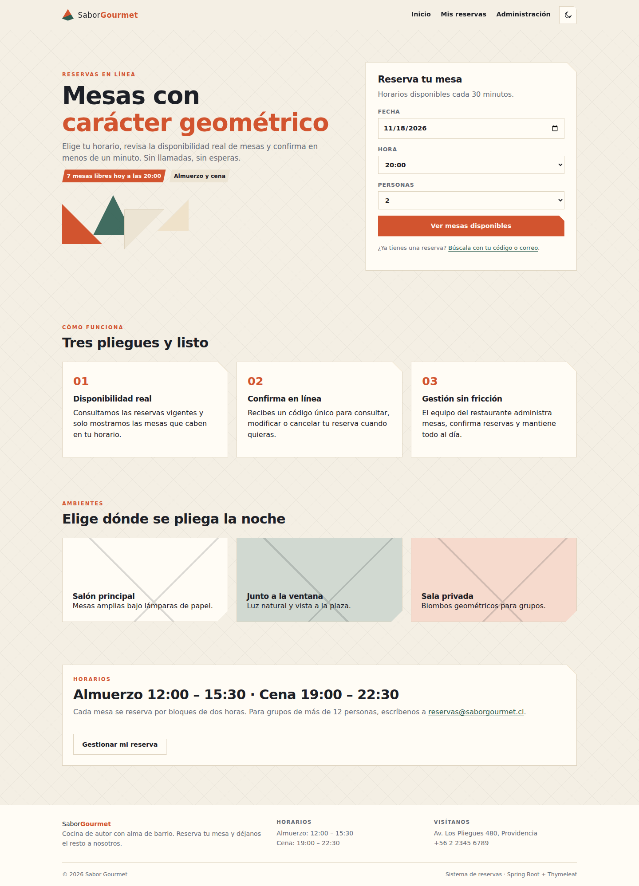
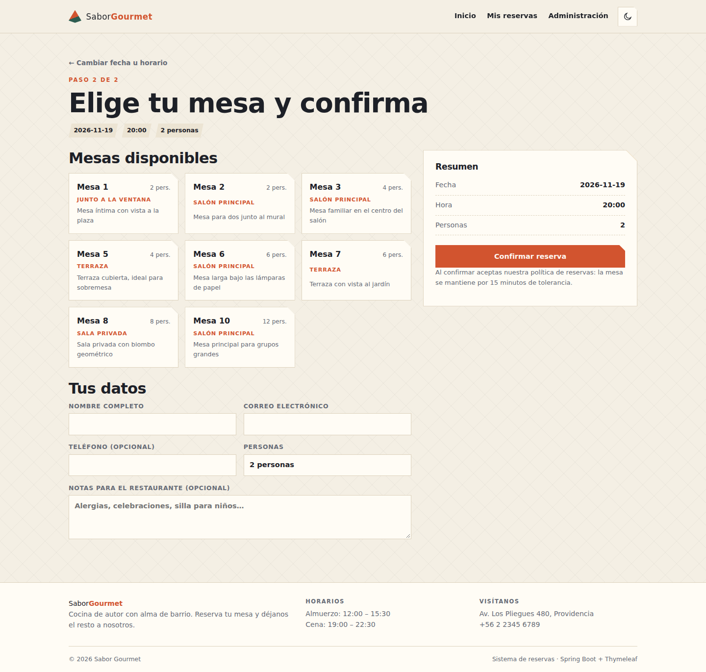
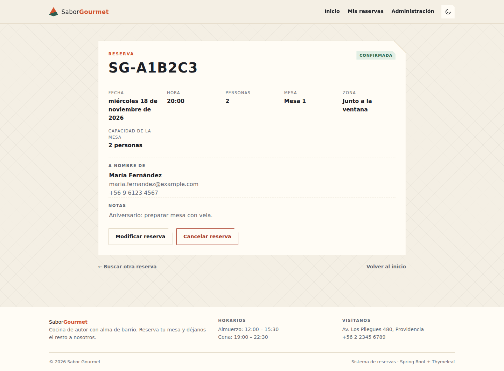
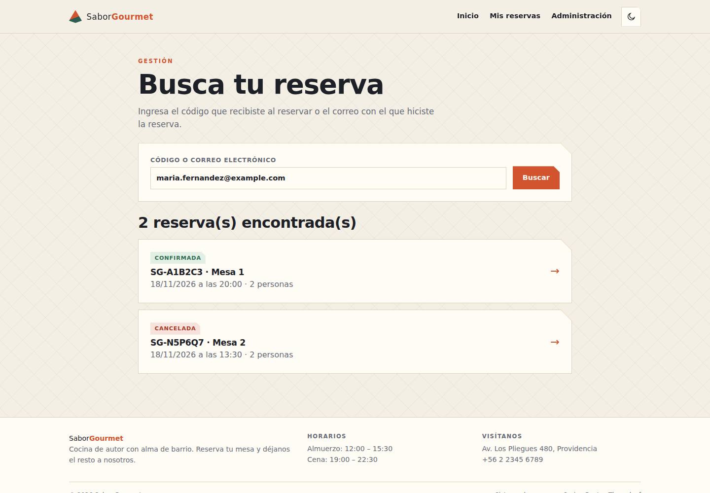
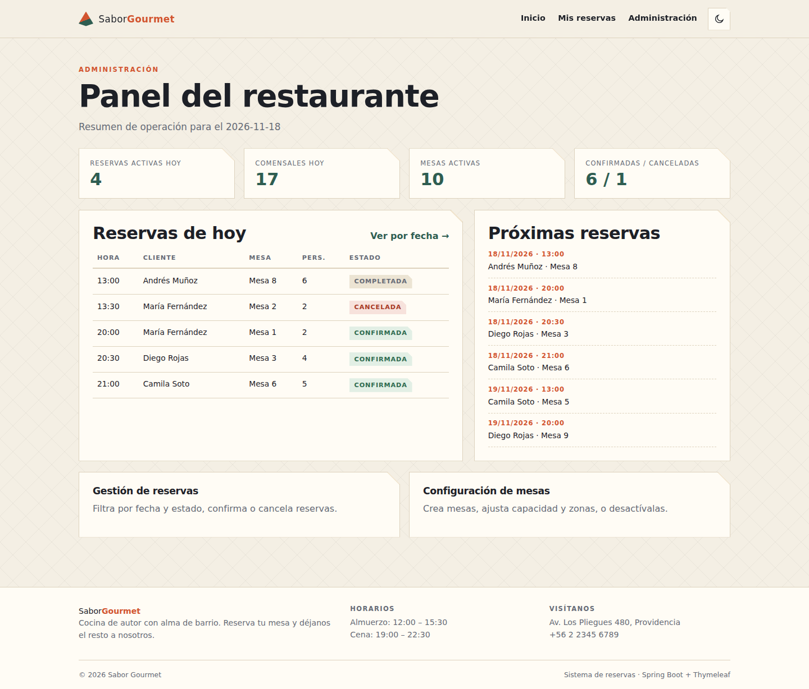
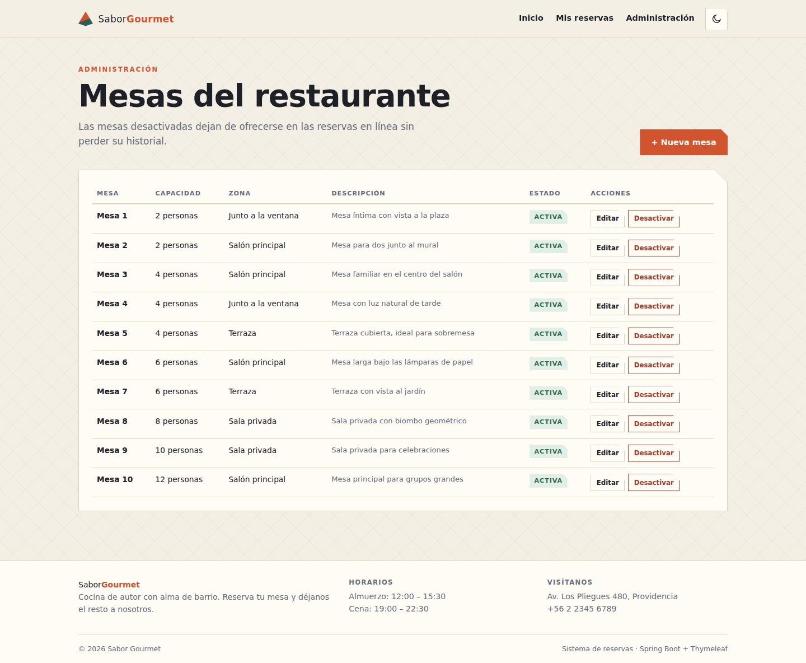
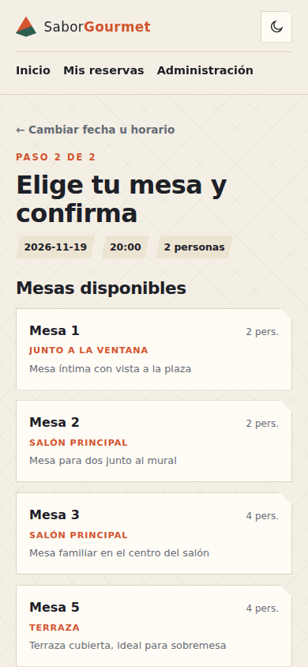

# Sabor Gourmet — Sistema de reservas de mesa

Aplicación web para el restaurante **Sabor Gourmet** que reemplaza el sistema manual de reservas por
uno en línea. Los clientes consultan la disponibilidad real de mesas, reservan en segundos y pueden
consultar, modificar o cancelar su reserva con un código. El personal del restaurante administra las
mesas y el estado de las reservas desde un panel privado.

Proyecto académico de **Desarrollo de Software Web II** (IPSS), construido con **Spring Boot,
Spring MVC, Spring Data JPA y Thymeleaf**, con una interfaz responsive de estilo **Origami
Geométrico** y modo claro/oscuro.

## Tabla de contenidos

1. [Funcionalidades](#funcionalidades)
2. [Stack tecnológico](#stack-tecnológico)
3. [Patrón de diseño y arquitectura](#patrón-de-diseño-y-arquitectura)
4. [Modelo de datos](#modelo-de-datos)
5. [Reglas de negocio](#reglas-de-negocio)
6. [Componentes, controladores y módulos](#componentes-controladores-y-módulos)
7. [Vistas y estilo visual](#vistas-y-estilo-visual)
8. [Requisitos para la ejecución](#requisitos-para-la-ejecución)
9. [Pasos de ejecución](#pasos-de-ejecución)
10. [Rutas de la aplicación](#rutas-de-la-aplicación)
11. [Estructura de directorios](#estructura-de-directorios)
12. [Capturas de pantalla](#capturas-de-pantalla)
13. [Cumplimiento de la rúbrica Unidad 2](#cumplimiento-de-la-rúbrica-unidad-2)
14. [Alcance y limitaciones](#alcance-y-limitaciones)

## Funcionalidades

**Clientes**

- Consulta de disponibilidad por fecha, hora y cantidad de personas, en turnos de almuerzo y cena.
- Reserva en línea con selección de mesa, datos de contacto y notas para el restaurante.
- Código único de reserva (`SG-XXXXXX`) para volver a consultarla.
- Búsqueda de reservas por código o por correo electrónico.
- Modificación de fecha, hora, mesa, cantidad de personas y datos de contacto.
- Cancelación en línea mientras la reserva siga vigente.

**Personal del restaurante**

- Panel con métricas del día: reservas activas, comensales, mesas activas y estados.
- Listado de reservas por fecha y estado, con cambio de estado (confirmar, completar, cancelar).
- Configuración de mesas: creación, edición de capacidad/zona/descripción y activación o
  desactivación sin perder el historial de reservas.

**Transversal**

- Validación de formularios en cliente (HTML5) y servidor (Bean Validation + reglas de negocio).
- Interfaz responsive, modo claro/oscuro persistido en `localStorage` y mensajes de error claros.
- Datos de demostración cargados automáticamente la primera vez.

## Stack tecnológico

| Tecnología | Versión | Uso |
| --- | --- | --- |
| Java | 21 (LTS) | Lenguaje |
| Spring Boot | 3.5.6 | Arranque, configuración y servidor embebido Tomcat |
| Spring MVC | 6.2 | Controladores y rutas HTTP |
| Thymeleaf | 3.1 | Motor de plantillas del lado del servidor |
| Spring Data JPA / Hibernate | 6.x | Persistencia y repositorios |
| Bean Validation | 3.x | Validación declarativa de formularios |
| H2 Database | 2.3 | Base de datos SQL embebida en archivo |
| Maven Wrapper | 3.9.16 | Build reproducible |
| HTML5 + CSS3 + JavaScript | — | Vistas, estilo origami, tema y diálogos de confirmación |
| JUnit 5 + AssertJ | — | Pruebas de reglas de negocio |

No se usan frameworks de JavaScript ni dependencias de UI: el estilo y el comportamiento se
resuelven con CSS y un único archivo JS de 30 líneas.

## Patrón de diseño y arquitectura

El proyecto aplica **MVC en capas con el patrón Repository**:

```
Navegador
   │  HTTP
   ▼
Controller  (Spring MVC, @Controller)      ← recibe la petición y elige la vista
   │
   ▼
Service     (@Service, reglas de negocio)  ← disponibilidad, validaciones, códigos
   │
   ▼
Repository  (Spring Data JPA)              ← consultas a la base de datos
   │
   ▼
Entity      (@Entity)                      ← Cliente, Mesa, Reserva
   │
   ▼
Thymeleaf   (templates/*.html)             ← renderiza HTML en el servidor
```

**Justificación:** el controlador solo traduce HTTP y prepara el modelo; el servicio concentra las
reglas que no deben depender de la vista (bloques de dos horas, capacidad, turnos, anticipación) y
los repositorios declaran consultas derivadas sin SQL manual. Las vistas Thymeleaf no contienen
lógica de negocio. Esto permite cambiar la interfaz sin tocar las reglas y probar el servicio sin
levantar el navegador.

Se usan además estos patrones y convenciones:

- **DTO de formulario** (`ReservaForm`, `MesaForm`) con anotaciones de validación, separado de las
  entidades JPA. Así la vista no puede modificar campos que no le corresponden (por ejemplo el
  estado o el código de una reserva).
- **Post/Redirect/Get** en todos los envíos de formulario: evita reenvíos al recargar la página y
  usa mensajes flash para confirmar la operación.
- **Repository** de Spring Data para cada agregado, con consultas derivadas del nombre del método.
- **Errores de negocio centralizados** en `ReglaNegocioException` y `GlobalExceptionHandler`.

## Modelo de datos

| Entidad | Campos principales | Relaciones |
| --- | --- | --- |
| `Cliente` | `id`, `nombre`, `email` (único), `telefono` | 1 cliente → N reservas |
| `Mesa` | `id`, `numero` (único), `capacidad`, `zona`, `activa`, `descripcion` | 1 mesa → N reservas |
| `Reserva` | `id`, `codigo` (único), `fecha`, `hora`, `personas`, `estado`, `notas`, `creadaEn` | N reservas → 1 cliente y 1 mesa |

`EstadoReserva` es un enumerado con `CONFIRMADA`, `CANCELADA` y `COMPLETADA`. `ZonaMesa` agrupa
`SALON`, `VENTANA`, `TERRAZA` y `PRIVADO`.

El esquema lo genera Hibernate (`ddl-auto=update`) sobre un archivo H2 en `./data/`, y
`DataInitializer` inserta 10 mesas, 4 clientes y 8 reservas de ejemplo solo cuando la base está
vacía.

## Reglas de negocio

1. **Turnos de atención:** almuerzo de 12:00 a 15:30 y cena de 19:00 a 22:30, con reservas cada 30
   minutos.
2. **Bloque de dos horas:** una reserva ocupa su mesa desde la hora de inicio hasta dos horas
   después; no se ofrecen mesas con otra reserva que se solape dentro de ese bloque.
3. **Capacidad:** solo se muestran mesas activas con capacidad mayor o igual al grupo. Las reservas
   en línea aceptan de 1 a 12 personas.
4. **Fechas:** desde hoy hasta 60 días de anticipación, sin horarios ya pasados del día actual.
5. **Estados:** una reserva cancelada deja de bloquear la mesa. Una reserva pasada, cancelada o
   completada no puede modificarse ni cancelarse desde el sitio público.
6. **Clientes únicos:** se reutiliza el cliente registrado con el mismo correo y se actualizan sus
   datos de contacto, en lugar de duplicarlo.
7. **Mesas con historial:** no se eliminan, se desactivan para dejar de ofrecerse sin perder las
   reservas asociadas.

Estas reglas viven en `ReservaService` y están cubiertas por pruebas automatizadas.

## Componentes, controladores y módulos

| Componente | Responsabilidad |
| --- | --- |
| `SaborGourmetApplication` | Arranque de Spring Boot |
| `HomeController` | Portada, sugerencia de horario y disponibilidad destacada |
| `ReservaController` | Crear, consultar, buscar, modificar y cancelar reservas |
| `AdminController` | Panel, filtros de reservas, CRUD y activación de mesas |
| `GlobalExceptionHandler` | Página de error legible para reglas de negocio |
| `ReservaService` | Disponibilidad, solapamientos, códigos, estados y validaciones |
| `MesaService` | Alta, edición y activación de mesas; unicidad del número |
| `ClienteService` | Reutilización de clientes por correo |
| `ReservaRepository`, `MesaRepository`, `ClienteRepository` | Persistencia con Spring Data JPA |
| `ReservaForm`, `MesaForm` | DTO con validación de formularios |
| `Agenda` | Turnos, horarios válidos y etiquetas de turno |
| `DataInitializer` | Datos de demostración |
| `Cliente`, `Mesa`, `Reserva`, `EstadoReserva`, `ZonaMesa` | Modelo de dominio |

## Vistas y estilo visual

El diseño sigue el estilo **Origami Geométrico**: papel cálido, paneles con esquina doblada,
triángulos y pliegues, tipografía de alto contraste y acentos terracota/verde. Se implementa con
variables CSS en `static/css/styles.css`:

- `:root` define los tokens del modo claro y `[data-theme="dark"]` los del modo oscuro.
- El botón de tema alterna `data-theme` en `<html>`, guarda la elección en `localStorage` y, si no
  hay preferencia guardada, respeta `prefers-color-scheme`.
- La cuadrícula de fondo, los cortes diagonales (`clip-path`) y las esquinas dobladas son solo CSS,
  sin imágenes externas.
- Formularios con etiquetas visibles, foco marcado, mensajes de error asociados y diálogos de
  confirmación antes de cancelar o desactivar. Respeta `prefers-reduced-motion`.

Plantillas: `index`, `reservas/nueva`, `reservas/editar`, `reservas/detalle`,
`reservas/buscar`, `admin/panel`, `admin/reservas`, `admin/mesas`, `admin/mesa-form`, y las páginas
de error. Los fragmentos compartidos (cabecera, mensajes flash y pie) viven en
`templates/fragments/layout.html`.

## Requisitos para la ejecución

- **JDK 21** (`java -version`).
- No es necesario instalar Maven: el proyecto incluye **Maven Wrapper** (`./mvnw`).
- Puertos libres: **8080** (aplicación). La consola H2 usa el mismo puerto.
- Navegador moderno (Chrome, Edge, Firefox o Safari actuales). La interfaz usa `clip-path` y
  `:has()`.

## Pasos de ejecución

```bash
# 1. Clonar el repositorio
git clone https://github.com/pablofsj/saborgourmet_app.git
cd saborgourmet_app

# 2. Ejecutar las pruebas (opcional)
./mvnw test

# 3. Levantar la aplicación
./mvnw spring-boot:run
```

Abrir <http://localhost:8080>. La base de datos H2 se crea en `./data/saborgourmet.mv.db` y los
datos de demostración se cargan la primera vez.

Alternativa con JAR:

```bash
./mvnw clean package
java -jar target/saborgourmet_app-1.0.0.jar
```

**Consola de base de datos:** <http://localhost:8080/h2-console>, JDBC URL
`jdbc:h2:file:./data/saborgourmet`, usuario `sa`, contraseña vacía.

**Reiniciar los datos de demostración:** detener la aplicación, borrar `data/` y volver a
levantarla.

**Códigos de ejemplo del seed** (fecha relativa al día de la primera ejecución):

| Código | Cliente | Cuándo |
| --- | --- | --- |
| `SG-A1B2C3` | maria.fernandez@example.com | Hoy 20:00, Mesa 1 |
| `SG-D4E5F6` | diego.rojas@example.com | Hoy 20:30, Mesa 3 |
| `SG-G7H8J9` | camila.soto@example.com | Hoy 21:00, Mesa 6 |
| `SG-R8S9T2` | diego.rojas@example.com | Mañana 20:00, Mesa 9 |

## Rutas de la aplicación

| Método | Ruta | Descripción |
| --- | --- | --- |
| GET | `/` | Portada y formulario de búsqueda de disponibilidad |
| GET | `/reservas/nueva` | Paso 2: mesas disponibles y datos del cliente |
| POST | `/reservas` | Crea la reserva y redirige al código generado |
| GET | `/reservas/buscar` | Búsqueda por código o correo |
| GET | `/reservas/{codigo}` | Detalle tipo ticket de la reserva |
| GET | `/reservas/{codigo}/editar` | Formulario de modificación |
| POST | `/reservas/{codigo}/editar` | Guarda los cambios |
| POST | `/reservas/{codigo}/cancelar` | Cancela la reserva |
| GET | `/admin` | Panel del restaurante |
| GET | `/admin/reservas` | Reservas filtradas por fecha y estado |
| POST | `/admin/reservas/{id}/estado` | Cambia el estado de una reserva |
| GET | `/admin/mesas` | Listado y estado de mesas |
| GET | `/admin/mesas/nueva` | Formulario de nueva mesa |
| POST | `/admin/mesas` | Crea una mesa |
| GET | `/admin/mesas/{id}/editar` | Formulario de edición |
| POST | `/admin/mesas/{id}` | Actualiza una mesa |
| POST | `/admin/mesas/{id}/estado` | Activa o desactiva una mesa |
| GET | `/h2-console` | Consola de desarrollo de H2 |

## Estructura de directorios

```
saborgourmet_app/
├── pom.xml                        # Dependencias y build Maven
├── mvnw / mvnw.cmd                # Maven Wrapper
├── AGENTS.md                      # Contexto local para agentes (no versionado)
├── README.md
├── docs/screenshots/              # Capturas usadas en este informe
├── data/                          # Base H2 generada al ejecutar (no versionada)
└── src/
    ├── main/
    │   ├── java/com/saborgourmet/app/
    │   │   ├── SaborGourmetApplication.java
    │   │   ├── config/DataInitializer.java
    │   │   ├── controller/        # HomeController, ReservaController, AdminController,
    │   │   │                      # GlobalExceptionHandler
    │   │   ├── dto/               # ReservaForm, MesaForm
    │   │   ├── model/             # Cliente, Mesa, Reserva, EstadoReserva, ZonaMesa
    │   │   ├── repository/        # ClienteRepository, MesaRepository, ReservaRepository
    │   │   ├── service/           # ReservaService, MesaService, ClienteService,
    │   │   │                      # ReglaNegocioException
    │   │   └── util/Agenda.java   # Turnos y horarios del restaurante
    │   └── resources/
    │       ├── application.properties
    │       ├── static/css/styles.css
    │       ├── static/js/app.js
    │       └── templates/
    │           ├── fragments/layout.html
    │           ├── index.html
    │           ├── reservas/      # nueva, editar, detalle, buscar
    │           ├── admin/         # panel, reservas, mesas, mesa-form
    │           └── error.html, error/negocio.html
    └── test/java/com/saborgourmet/app/service/
        └── ReservaServiceTest.java  # 6 pruebas de disponibilidad y reglas
```

## Capturas de pantalla

### Portada en modo claro

Formulario de reserva con fecha, hora y personas; collage geométrico y accesos a gestión y
administración.



### Portada en modo oscuro

El mismo diseño con los tokens oscuros; la preferencia se guarda en el navegador.


### Disponibilidad de mesas

Paso 2 del flujo: solo aparecen mesas activas con capacidad suficiente y libres en el bloque de dos
horas solicitado.



### Detalle de la reserva

Ticket con código único, estado, datos del cliente, notas y acciones de modificar o cancelar.



### Búsqueda de reservas

El cliente puede buscar por código o por correo y ver todas sus reservas con su estado actual.



### Panel del restaurante

Métricas del día, reservas vigentes y próximas, con accesos a la gestión completa.



### Gestión de reservas

Filtros por fecha y estado, contacto del cliente y acciones para confirmar, completar o cancelar.


### Configuración de mesas

Listado de mesas con capacidad, zona, estado y acciones de edición y activación.



### Vista móvil

La portada y el formulario se reordenan a una columna, manteniendo la navegación y los objetivos
táctiles.




## Cumplimiento de la rúbrica Unidad 2

| Indicador | Cómo se cumple |
| --- | --- |
| **Funcionalidad completa** | Flujo completo de reserva (crear, consultar, modificar, cancelar) y administración de mesas y estados, sin errores en la revisión de rutas ni en los registros. |
| **Calidad del código** | Separación en capas, DTO con validación, nombres en español, reglas comentadas solo donde no se explican solas, errores centralizados y 6 pruebas automatizadas. |
| **Implementación de MVC** | Controladores delgados, servicios con la lógica y repositorios JPA; Thymeleaf solo presenta el modelo. Cada capa tiene una única responsabilidad. |
| **Integración y uso de datos** | Tres repositorios de Spring Data con consultas derivadas, sin SQL manual ni duplicación de clientes; relaciones JPA entre las tres entidades. |
| **Calidad del informe** | Este README con tabla de contenidos, stack, arquitectura, modelo de datos, reglas, rutas, estructura, capturas descritas y criterios de cumplimiento. |

## Alcance y limitaciones

- **El panel `/admin` no tiene autenticación.** La evaluación no pedía seguridad y agregarla
  habría ampliado el alcance; para producción corresponde Spring Security con roles de cliente y
  personal. `shortcut:` documentado también en `AGENTS.md`.
- **No se envían correos reales.** El mensaje de confirmación es informativo y el código se muestra
  en pantalla; integrar SMTP es el siguiente paso natural.
- **H2 en archivo** es suficiente para el trabajo académico. Para un despliegue real se cambia la
  URL y el driver por PostgreSQL o MySQL sin tocar los repositorios.
- La fecha de las reservas de demostración se calcula al primer arranque; si la base queda mucho
  tiempo sin reiniciarse, las reservas del seed aparecerán como pasadas.

---

Proyecto académico de **Desarrollo de Software Web II** — Pablo Figueroa Saint-Jour.
