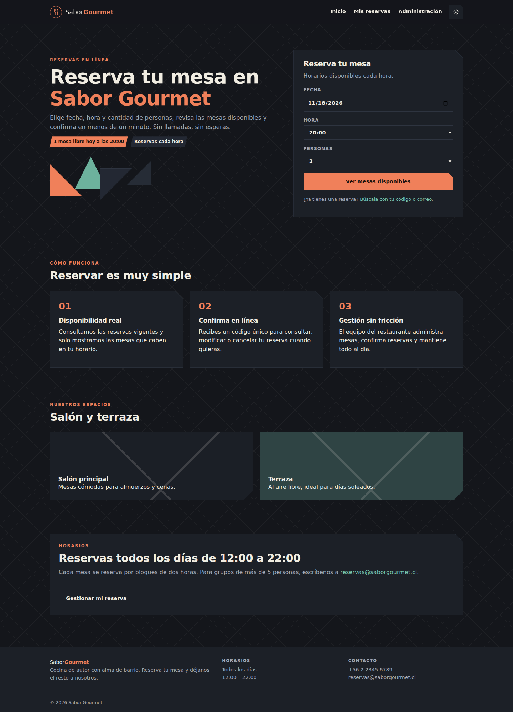
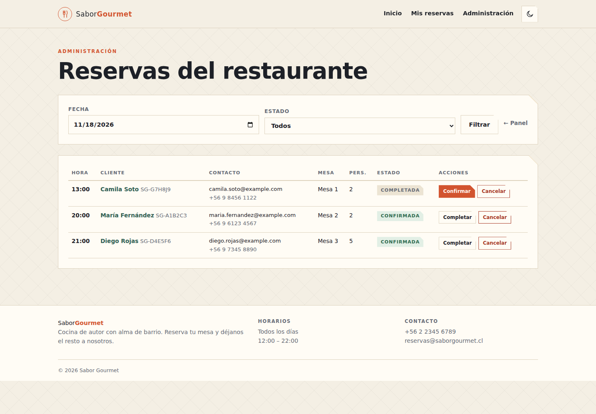
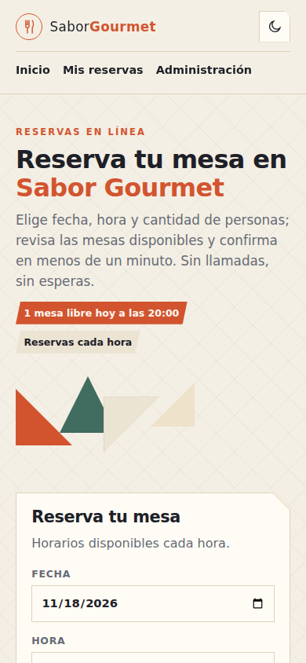

# Sabor Gourmet — Sistema de reservas de mesa

Aplicación web para el restaurante **Sabor Gourmet** que permite reservar mesas en línea, consultar
la disponibilidad real, modificar o cancelar una reserva con un código, y administrar las mesas y
reservas desde un panel interno. Está construida con **Spring Boot, Spring MVC, Spring Data JPA y
Thymeleaf**, con una interfaz responsive de estilo **Origami Geométrico** y modo claro/oscuro.

## Tabla de contenidos

1. [Funcionalidades](#funcionalidades)
2. [Stack tecnológico](#stack-tecnológico)
3. [Patrón de diseño](#patrón-de-diseño)
4. [Modelo de datos](#modelo-de-datos)
5. [Reglas de negocio](#reglas-de-negocio)
6. [Componentes principales](#componentes-principales)
7. [Vistas y estilo visual](#vistas-y-estilo-visual)
8. [Requisitos](#requisitos)
9. [Pasos de ejecución](#pasos-de-ejecución)
10. [Rutas de la aplicación](#rutas-de-la-aplicación)
11. [Estructura de directorios](#estructura-de-directorios)
12. [Capturas de pantalla](#capturas-de-pantalla)
13. [Cumplimiento de la rúbrica](#cumplimiento-de-la-rúbrica)

## Funcionalidades

**Clientes**

- Consulta de disponibilidad por fecha, hora y cantidad de personas.
- Reserva en línea con selección de mesa y datos de contacto.
- Código único (`SG-XXXXXX`) para consultar, modificar o cancelar la reserva.

**Personal del restaurante**

- Panel con reservas del día, próximas reservas y métricas básicas.
- Listado de reservas por fecha y estado, con cambio de estado.
- Creación, edición y activación/desactivación de mesas sin perder el historial.

**Transversal**

- Validación de formularios en cliente y servidor.
- Mensajes de error claros, modo claro/oscuro y datos de demostración precargados.

## Stack tecnológico

| Capa | Tecnología |
| --- | --- |
| Lenguaje | Java 21 |
| Backend | Spring Boot (Spring MVC y Spring Data JPA) |
| Vistas | Thymeleaf, HTML5, CSS3 y JavaScript |
| Base de datos | H2 embebida |
| Build y pruebas | Maven Wrapper y JUnit 5 |

## Patrón de diseño

El proyecto usa **MVC en capas** con el patrón **Repository**:

- **Controller:** recibe las peticiones HTTP y prepara el modelo para la vista.
- **Service:** contiene la lógica de negocio (disponibilidad, validaciones, estados).
- **Repository:** acceso a datos con Spring Data JPA.
- **View:** plantillas Thymeleaf, sin lógica de negocio.

La separación permite probar las reglas sin navegador y cambiar la interfaz sin tocar el dominio.
Los formularios usan DTO validados y todas las operaciones siguen **Post/Redirect/Get** con mensajes
flash.

## Modelo de datos

| Entidad | Campos principales | Relación |
| --- | --- | --- |
| `Cliente` | `nombre`, `email` (único), `telefono` | 1 cliente → N reservas |
| `Mesa` | `numero` (único), `capacidad`, `zona`, `activa` | 1 mesa → N reservas |
| `Reserva` | `codigo` (único), `fecha`, `hora`, `personas`, `estado`, `notas` | N reservas → 1 cliente y 1 mesa |

Zonas: **Salón** y **Terraza**. Estados: **Confirmada**, **Cancelada** y **Completada**.

## Reglas de negocio

- Reservas cada hora, de 12:00 a 22:00, desde hoy y hasta 60 días de anticipación.
- Una mesa queda ocupada durante dos horas desde el inicio de la reserva.
- Solo se ofrecen mesas activas con capacidad suficiente; el máximo en línea es **5 personas**.
- Las reservas canceladas liberan la mesa.
- Una reserva pasada, cancelada o completada no se modifica ni cancela desde el sitio público.
- El cliente se reutiliza por correo electrónico para no duplicar registros.

## Componentes principales

| Componente | Responsabilidad |
| --- | --- |
| `HomeController`, `ReservaController`, `AdminController` | Portada, reservas y administración |
| `ReservaService`, `MesaService`, `ClienteService` | Reglas de negocio y disponibilidad |
| `ClienteRepository`, `MesaRepository`, `ReservaRepository` | Consultas con Spring Data JPA |
| `ReservaForm`, `MesaForm` | DTO con validación de formularios |
| `DataInitializer` | Datos de demostración |
| `templates/` y `static/` | Vistas Thymeleaf, estilos y JavaScript |

## Vistas y estilo visual

La interfaz sigue el estilo **Origami Geométrico**: papel cálido, pliegues, triángulos y acentos
terracota/verde. Los tokens CSS definen los modos claro y oscuro, y la preferencia se guarda en el
navegador. El diseño es responsive y respeta `prefers-reduced-motion`.

## Requisitos

- **JDK 21**.
- No hace falta instalar Maven: el proyecto incluye **Maven Wrapper**.
- Puerto **8080** libre y un navegador actualizado.

## Pasos de ejecución

**Linux / macOS**

```bash
git clone https://github.com/pablofsj/saborgourmet_app.git
cd saborgourmet_app
./mvnw spring-boot:run
```

**Windows (PowerShell o CMD)**

```bat
git clone https://github.com/pablofsj/saborgourmet_app.git
cd saborgourmet_app
mvnw.cmd spring-boot:run
```

Abrir <http://localhost:8080>. La base H2 se crea en `./data/` y los datos de demostración se cargan
la primera vez. Para ejecutar las pruebas: `./mvnw test` (Linux/macOS) o `mvnw.cmd test` (Windows).

Alternativa con JAR (en ambos sistemas):

```bash
./mvnw clean package
java -jar target/saborgourmet_app-1.0.0.jar
```

**Consola H2:** <http://localhost:8080/h2-console>, URL `jdbc:h2:file:./data/saborgourmet`, usuario
`sa` sin contraseña. Para reiniciar los datos de demostración, detener la aplicación y borrar la
carpeta `data/`.

Reservas de ejemplo:

| Código | Cliente | Cuándo |
| --- | --- | --- |
| `SG-A1B2C3` | maria.fernandez@example.com | Hoy 20:00, Mesa 2 |
| `SG-D4E5F6` | diego.rojas@example.com | Hoy 21:00, Mesa 3 |
| `SG-N5P6Q7` | diego.rojas@example.com | Mañana 19:00, Mesa 3 |

## Rutas de la aplicación

| Método | Ruta | Descripción |
| --- | --- | --- |
| GET | `/` | Portada y búsqueda de disponibilidad |
| GET | `/reservas/nueva` | Mesas disponibles y datos del cliente |
| POST | `/reservas` | Crea la reserva |
| GET | `/reservas/buscar` | Búsqueda por código o correo |
| GET | `/reservas/{codigo}` | Detalle de la reserva |
| GET/POST | `/reservas/{codigo}/editar` | Modificación de la reserva |
| POST | `/reservas/{codigo}/cancelar` | Cancelación |
| GET | `/admin` | Panel del restaurante |
| GET | `/admin/reservas` | Reservas por fecha y estado |
| POST | `/admin/reservas/{id}/estado` | Cambio de estado |
| GET/POST | `/admin/mesas` | Listado y creación de mesas |
| GET/POST | `/admin/mesas/{id}` | Edición y activación de mesas |

## Estructura de directorios

```
saborgourmet_app/
├── pom.xml
├── mvnw / mvnw.cmd
├── README.md
├── docs/screenshots/
├── data/                          # Base H2 generada (no versionada)
└── src/
    ├── main/
    │   ├── java/com/saborgourmet/app/
    │   │   ├── SaborGourmetApplication.java
    │   │   ├── config/DataInitializer.java
    │   │   ├── controller/        # Home, Reserva, Admin y errores
    │   │   ├── dto/               # ReservaForm, MesaForm
    │   │   ├── model/             # Cliente, Mesa, Reserva, enums
    │   │   ├── repository/        # Repositorios Spring Data
    │   │   ├── service/           # Lógica de negocio
    │   │   └── util/Agenda.java   # Horarios de reserva
    │   └── resources/
    │       ├── application.properties
    │       ├── static/            # CSS y JavaScript
    │       └── templates/         # Vistas Thymeleaf
    └── test/java/.../ReservaServiceTest.java
```

## Capturas de pantalla

**Portada en modo claro y oscuro.** Formulario de reserva y accesos a gestión y administración.




**Disponibilidad.** Solo aparecen mesas activas, con capacidad suficiente y libres en el horario.


**Detalle de la reserva.** Código, estado, datos del cliente y acciones de modificar o cancelar.


**Búsqueda de reservas.** Por código o correo electrónico.


**Panel del restaurante.** Reservas del día, próximas reservas y métricas.


**Gestión de reservas.** Filtros por fecha y estado, con cambio de estado.



**Configuración de mesas.** Creación, edición y activación de mesas.


**Vista móvil.** La portada y el formulario se adaptan a una columna.




## Cumplimiento de la rúbrica

| Indicador | Cómo se cumple |
| --- | --- |
| **Funcionalidad completa** | Reserva, consulta, modificación y cancelación en línea, más administración de mesas y estados. |
| **Calidad del código** | Capas separadas, DTO validados, errores centralizados y pruebas automatizadas. |
| **Implementación de MVC** | Controladores delgados, lógica en servicios, persistencia en repositorios y vistas Thymeleaf. |
| **Integración y uso de datos** | Spring Data JPA para las tres entidades, con relaciones y consultas derivadas. |
| **Calidad del informe** | README con stack, arquitectura, modelo, reglas, rutas, ejecución y capturas descritas. |
